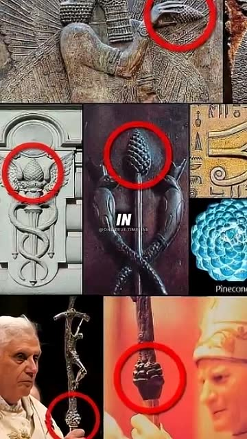
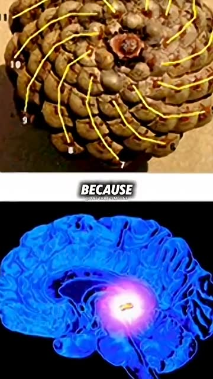
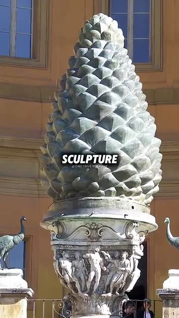
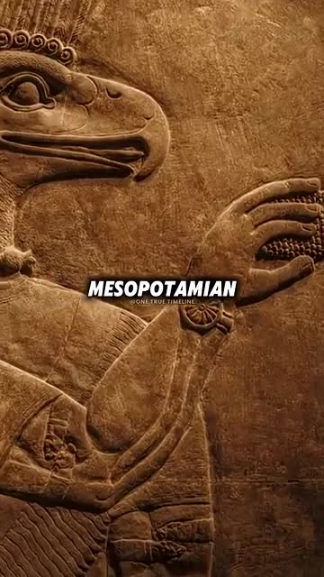
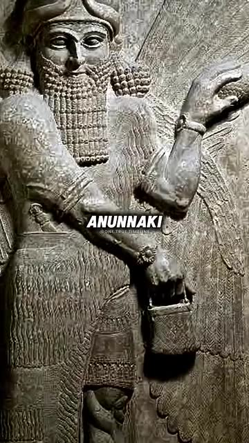

# The pine cone in ancient religious art, at the Vatican and on the pope's staff represents the pineal gland, where DMT is made

<!-- auto:card -->

Misleading

**Pine cones really do appear in Assyrian, Greek, Roman and Christian art, and the pineal gland really is named after the pine cone. But no ancient source links the two. The Vatican's pine cone is a Roman bronze that stood in the fountain of Old St Peter's, the Assyrian cones were ritual sprinklers, and the pope's staff is topped by a crucifix. Whether the pineal makes meaningful DMT in humans is unproven.**

**Said by** [Joe Rogan](../people/joe-rogan.md) **in** [The Joe Rogan Experience #2091: Diana Walsh Pasulka](../sources/jre-2091-diana-walsh-pasulka.md) at 1:08:25

**Claim type:** Interpretation · **Confidence in this verdict:** high · **Checked:** 2026-10-26 · **My prior:** 75% likely true

<!-- /auto:card -->

## What was said

From the YouTube transcript of
[JRE #2091](../sources/jre-2091-diana-walsh-pasulka.md), chapter "The
pineal gland as a gateway". The transcript has no speaker labels, so the
names in [brackets] are inferred from context, and I've added punctuation.

> **1:08:01** [Pasulka] "We had a professor that took us on a tour… We
> were outside in this courtyard area, where the pine cone is, and he said,
> 'Do you know the significance of the pine cone?' And I said, 'Does it
> represent the pineal gland?' And he said yes."
>
> **1:08:25** [Rogan] "That's what… it's also in the Pope's staff. If you
> look at the staff that the Pope carries, the staff has a pine… see if you
> can get a photo of the staff the Pope carries… **it has a pine cone in the
> center of it.** The pine cone, which is depicted in many, many ancient
> pieces of art, religious art, and **it represents the pineal gland because
> it's similar in appearance to a pine cone.** And… this pine cone, which
> also I'm sure probably represents the Fibonacci sequence, which also
> represents itself in the pine cone… that's the seed of the soul, **that's
> where DMT is made.**"
>
> **1:09:08** "The reason why they have an immense pine cone, I mean,
> that's not an accident." — "No, of course not."
>
> **1:09:33** [Rogan] "And look, you see it there in that ancient
> Mesopotamian art, it's probably Sumerian, with that god… that's the
> Anunnaki carried that thing. And then the fact that they're holding it
> specifically, that they're telling you, like, this is what's up… this is
> the connection to the gods."

Pasulka then adds that a parish priest once gave her a little gold pine
cone, and calls it "an icon of this thing… inside of us that is this
gateway."

The owner first saw this as a
[34-second YouTube Short](../sources/pine-cone-pineal-short.md) that cuts
Rogan's lines together with a montage of images. Those images are checked
[below](#what-the-images-in-the-short-actually-show).

## Steelman

Pine cones really do turn up again and again in sacred art: in the hands of
winged figures on Assyrian palace walls, on the staffs of Dionysus'
followers, in the cult of Attis, and in the Vatican, which displays a
four-metre bronze one in a courtyard named after it. The pineal gland, a
small organ in the middle of the brain, really does look like a pine cone
and is named after one. Descartes called it the seat of the soul. And
researchers have detected DMT, the powerful psychedelic, in the pineal
glands of rats. So perhaps the ancients, through visions or meditation,
knew of a "gateway" organ in the head and encoded it in a symbol that
survived into Christianity.

## Short answer

**The ingredients are real. The connection between them is modern.**

- **Pine cones in religious art: true.** They're common in Assyrian, Greek, Roman and Christian art.
- **"It represents the pineal gland": no evidence.** No ancient text links the pine cone to the gland. Where we know what the cones meant, it was something else: a purifying sprinkler in Assyria, Dionysus and fertility in Greece, death and rebirth in Rome, eternal life in Christianity. The naming goes the other way: the physician Galen named the gland after the pine cone.
- **The Vatican's pine cone** is a Roman bronze from the 1st–2nd century AD that decorated a public monument in ancient Rome. From at least the 12th century it stood in the fountain where pilgrims washed outside Old St Peter's. The Vatican Museums' own history of it gives it no pineal meaning, and notes that "the most extravagant legends" have grown up around it.
- **The pope's staff** is topped by a crucifix. The "pine cone" in the photos is a decorative knob on the shaft.
- **"That's where DMT is made": overstated.** Tiny amounts of DMT have been found in rat pineal glands, but also in other brain areas, and those don't need the pineal. Whether the human pineal makes a meaningful amount is unproven, and leading researchers think it doesn't.

## The full picture

### The timeline

The pineal–pine cone story only appears when you put the dates side by
side.

| When | What |
|---|---|
| 883–859 BC | Ashurnasirpal II's palace at Nimrud (Assyria, in today's Iraq) is decorated with winged figures holding a cone and a bucket. |
| 1st–2nd century AD | The bronze pine cone now in the Vatican is cast in Rome as a fountain, signed by Publius Cincius Salvius. |
| 2nd century AD | The physician **Galen** describes the gland and calls it *kōnarion*, "little cone" (from *kōnos*, pine cone), because in shape and size it resembles the nuts in the cones of the stone pine. It's named after the cone, not the other way round. He thinks it is an ordinary gland that supports blood vessels. |
| by the 12th century | The bronze cone stands in the *cantharus*, the fountain for ritual washing in the courtyard of Old St Peter's basilica. Dante mentions "the pine cone of St Peter's" in *Inferno* (canto 31). |
| 1608 / 1704 | Moved to the Vatican's Belvedere courtyard, then into its present niche on a Roman marble capital. |
| 1640 | **Descartes**, in a letter, calls the pineal gland "the principal seat of the soul, and the place in which all our thoughts are formed." This is the first time it's linked to the soul. |
| late 1800s | Scientists propose that the pineal is the remnant of a "third eye" (some reptiles have a light-sensing eye on top of the head). In 1888 **Helena Blavatsky**, founder of Theosophy (an esoteric religious movement), turns this into an "organ of spiritual vision." |
| 1958 | The gland's real job is found: it makes **melatonin**, the hormone that tracks day and night. |
| 1963 | Paul VI commissions the modern papal staff, a silver crucifix by Lello Scorzelli. |
| 2000 | Psychiatrist **Rick Strassman**'s book *DMT: The Spirit Molecule* suggests the pineal releases DMT at birth, in dreams and at death. |
| 2000s–2010s | Websites and videos join it all up: pine cone = pineal = third eye = DMT. |

The symbols are ancient. The idea that the gland is spiritual is 17th
century, the spiritual "third eye" is 19th century, and the DMT link is
from 2000. So
the Assyrians and Romans couldn't have meant what the modern story says,
unless they knew something that left no trace in any of their own
writings.

### What the pine cones actually meant

- **Assyria.** The winged figures are **apkallu**, protective spirits or
  sages. In Akkadian, the language of Assyria, the bucket is *banduddû*
  and the cone is *mullilu*, which means "**purifier**." Most scholars
  read the cone as a sprinkler dipped in holy water to purify people and
  objects. Some think it's a pine cone, others the male flower of the date
  palm, used to pollinate the sacred tree. Bowdoin College's museum
  describes the figures as "fertilizing or purifying the sacred tree."
  Either way, the meaning is purification or fertility. Nobody has found a
  text linking it to the head or the brain. These are **Neo-Assyrian**
  carvings, more than a thousand years after Sumerian civilization's
  heyday, and they show
  apkallu, not the **Anunnaki** (a group of major gods). The "Anunnaki
  carrying a handbag" idea comes from ancient-astronaut writers, not from
  Assyriology.
- **Greece and Rome.** The followers of Dionysus, god of wine, carried a
  **thyrsus**, a fennel stalk often topped with a pine cone (some
  historians argue the top was originally stylised ivy). In the cult of
  Attis and Cybele the pine tree stood for death and rebirth. Pine cones
  were also simply decorative, as on fountains and tombs.
- **Christianity.** The pine cone, from an evergreen tree, is usually read
  as a symbol of **eternal life and renewal**. That's how the Catholic news
  site Aleteia describes the Pigna. In the courtyard of Old St Peter's it
  crowned the fountain where pilgrims washed and drank before entering.
  The Catholic writer Joe Heschmeyer (Catholic Answers) says that reading
  the pineal gland into it is reading "way too much into a pine cone."

The pineal reading does circulate even in Catholic media. The same
Aleteia article adds that "art historians have also associated it with
spiritual enlightenment, as the pine cone resembles the brain's pineal
gland," without naming any. So Pasulka's tour guide may well have said
yes. But that's a modern interpretation being repeated, not evidence of
what the Romans or the early Church meant. The Vatican Museums' own
scholarly note on the Pigna (by the curator Claudia Valeri) mentions no
such meaning. Instead it remarks that "the most extravagant legends have
flourished" around it, such as the story that it once held the ashes of
the emperor Hadrian.

### The Vatican pine cone (the *Pigna*)

- A bronze pine cone nearly **4 metres** tall, signed by its maker,
  Publius Cincius Salvius, and dated to the **1st–2nd century AD**. Its
  scales were cast following the natural spiral pattern of a real cone.
- The Vatican Museums say it was made "to decorate an important public
  monument in ancient Rome (perhaps in the Campus Martius)." Other
  accounts place it near the Pantheon and the temple of Isis, or at the
  Baths of Agrippa, and say it spouted water from its tip. The Roman
  district Pigna is named after it.
- **By the 12th century** it stood in the *cantharus*, the washing fountain
  in the middle of the courtyard of Old St Peter's. In 1608 it moved to
  the Belvedere, and since 1704 it has stood in the great niche of what is
  now called the Cortile della Pigna ("pine cone courtyard"). It sits on a
  Roman marble capital from the Baths of Nero and Alexander Severus,
  carved with athletes. The Vatican Museums restored it in 2020.

So "the reason why they have an immense pine cone" is that the popes
inherited a famous Roman bronze and kept it. They didn't commission it.

### The pope's staff

The modern papal staff (the **ferula**) is a rod topped by a **crucifix**.
Its current design is by the sculptor Lello Scorzelli for Paul VI (1963).
John Paul II used it (and a lighter copy made in 1990), as did Benedict
XVI in his first years, and Francis went back to it in 2013. Its shaft has a decorative knob, called a
**knop**, which is standard on bishops' staffs and processional crosses.
Some medieval crosiers did use pine-cone ornaments (the V&A has a Venetian
ivory one from about 1350–70), and Heschmeyer allows that some papal ones might, "for
decorative reasons." I found no Church source giving any papal staff a
pineal meaning.

### The pineal gland and DMT

- **What the gland does.** It's about the size of a grain of rice (under
  0.2 g) and makes melatonin, about 30 micrograms a day.
- **What's been found.** In 2013 a team including Strassman reported DMT
  in fluid collected from the pineal gland of living rats. In 2019 a
  University of Michigan team (Dean et al., *Scientific Reports*) found
  the enzymes that make DMT in the rat pineal and also in the cortex and
  hippocampus. They measured DMT in the rat visual cortex, and it **rose
  after cardiac arrest even in rats whose pineal gland had been removed.**
  So even in rats, the pineal isn't the only source, and not the main one
  for the cortex.
- **In humans.** The 2019 team found the enzyme's genetic message (INMT
  mRNA) in human pineal and cortex tissue. DMT has been found in human
  body fluids only "in trace amounts," in the paper's words. Nobody has
  shown the human pineal releasing a psychoactive amount.
- **Expert view.** The pharmacologist David Nichols, a leading psychedelic
  chemist, reviewed the evidence in "DMT and the pineal gland: Separating
  fact from myth" (2018). He concluded the gland couldn't make enough DMT
  to affect consciousness. Strassman's own idea of pineal DMT surges at
  birth, in dreams and at death remains a hypothesis without direct
  evidence.

So "that's where DMT is made" takes "detected in small amounts in rats,
among other places" and turns it into "the human DMT factory."

### Fibonacci

Pine cones do grow their scales in two sets of spirals whose counts are
usually consecutive **Fibonacci numbers** (for example 8 and 13). That's
real botany, shared by sunflowers and pineapples. It says nothing about
the pineal gland, which isn't a spiral.

### Verdict

**Misleading**, with **high** confidence. The kernel is real: pine cones
are a widespread sacred motif, and the gland is named after one. But the
claim's central point, that the ancients and the Church used the pine cone
to *mean* the pineal gland, has no supporting evidence and runs against
what the sources say the cones meant. The pope's staff detail is wrong, and
the DMT detail is overstated.

## What the images in the Short actually show

The [Short](../sources/pine-cone-pineal-short.md) shows about fifteen
images in 34 seconds. I went through it frame by frame. Below are stills
from the clip itself, with its captions and red circles, so you can see
what it shows next to what each image actually is. Times are from the
start of the clip.

<figure markdown="span">
{ loading=lazy }
<figcaption markdown>**0:02 · Pope Francis's staff.** Real photo. It's the Scorzelli papal ferula, topped by a crucifix. The red circle marks the decorative knop on the shaft, which doesn't look like a pine cone.</figcaption>
</figure>

<figure markdown="span">
{ loading=lazy }
<figcaption markdown>**0:03 · "Pine cone" on a staff.** I couldn't identify this photo or staff. The lump does look cone-like: a knop of the kind found on many crosiers. Nothing says it's meant as a pineal gland.</figcaption>
</figure>

<figure markdown="span">
{ loading=lazy }
<figcaption markdown>**0:05 · "John Paul II".** The skin and hands look like a **wax figure or statue**, not a photograph of the pope. Unidentified.</figcaption>
</figure>

<figure markdown="span">
{ loading=lazy }
<figcaption markdown>**0:08 · Collage.** Mixed. The Assyrian relief is real. The snake staff is posted online as the "Staff of Osiris" (Turin, 1224 BC), but I found **no museum record** for it. The grey carving is unidentified. The Eye of Horus has nothing to do with pine cones, and the blue spiral is a computer graphic.</figcaption>
</figure>

<figure markdown="span">
{ loading=lazy }
<figcaption markdown>**0:10 · "Egypt".** The child holds **grapes**, not a pine cone. Grapes and a bird are a standard motif on Roman-era funerary portraits of children (for example from Palmyra, in Syria). Watermarked "FACEBOOK \| ANCIENT ARMENOIDS". Exact object unidentified.</figcaption>
</figure>

<figure markdown="span">
{ loading=lazy }
<figcaption markdown>**0:13 · Spirals and a glowing brain.** Real botany: pine cone scales grow in Fibonacci spirals. The brain is a stock 3D illustration showing where the gland is. Neither shows a connection.</figcaption>
</figure>

<figure markdown="span">
{ loading=lazy }
<figcaption markdown>**0:17 · "Soul".** Real anatomy, with the pineal coloured yellow. "Seat of the soul" is Descartes in 1640, not an ancient idea.</figcaption>
</figure>

<figure markdown="span">
{ loading=lazy }
<figcaption markdown>**0:22 · The Vatican pine cone.** Real: the *Pigna*, a Roman bronze of the 1st–2nd century AD, on a Roman capital carved with athletes. The peacocks are copies of Roman originals.</figcaption>
</figure>

<figure markdown="span">
{ loading=lazy }
<figcaption markdown>**0:25 · "Mesopotamian".** Real: a Neo-Assyrian palace relief of an eagle-headed *apkallu* spirit holding the *mullilu* ("purifier"), 9th century BC, of the kind from Nimrud.</figcaption>
</figure>

<figure markdown="span">
{ loading=lazy }
<figcaption markdown>**0:27 · "Anunnaki".** Real Assyrian relief, wrong label. It shows a winged protective spirit with cone and bucket, not one of the Anunnaki gods, and it isn't Sumerian.</figcaption>
</figure>

Not pictured: a shot of Rogan's laptop showing a Flickr image search (0:29),
from the episode itself, and a closing montage (0:31) that repeats the
images above. The bronze ball at the edge of the courtyard shots (0:20) is
a modern sculpture, Arnaldo Pomodoro's *Sphere within Sphere*.

**In short:** the Vatican pine cone and the Assyrian reliefs are genuine.
The staff images circle ordinary decorative knobs, one "pope" looks like a
wax figure, one "pine cone" is a bunch of grapes, one famous artefact
can't be traced to a museum, one caption names the wrong beings, and the
brain pictures are modern illustrations. None of the images shows a link
between pine cones and the pineal gland. They can only show that pine
cones existed.

!!! info "About these stills"
    They are low-resolution frames from the Short, shown here to comment on
    and check its content. They are not my images, and the clip's
    copyright belongs to its makers.

## Sources

**The pine cone in art and at the Vatican**

- Claudia Valeri (Vatican Museums), [*La Pina di San Pietro nei Musei Vaticani*](https://www.museivaticani.va/content/dam/museivaticani/pdf/eventi_novita/iniziative/eventi/2020/124_scheda_storico_artistica_pigna.pdf) (2020, in Italian): the curator's history of the Pigna. Maker's signature, 1st–2nd century date, "to decorate an important public monument", in the *cantharus* of Old St Peter's from the 12th century, moves in 1608 and 1704, the base capital, and the "most extravagant legends". Primary.
- Vatican Museums, [The Pinecone "returns" to the Niche of the Belvedere](https://www.museivaticani.va/content/museivaticani/en/eventi-e-novita/iniziative/Eventi/2020/restauro-pigna.html) (2020), and the [metals lab's restoration notes](https://www.museivaticani.va/content/dam/museivaticani/pdf/eventi_novita/iniziative/eventi/2020/124_scheda_pigna_laboratorio_metalli.pdf) (in Italian): height, the five cast sections, the scales numbered along the cone's natural spiral.
- Aleteia, [The story behind the Vatican's 13-foot pine cone sculpture](https://aleteia.org/2024/09/02/the-story-behind-the-vaticans-13-foot-pine-cone-sculpture/) (2024): "a symbol of renewal and eternal life"; mentions unnamed "art historians" linking it to the pineal gland; Pomodoro's sphere in the courtyard. Catholic news site.
- Turismo Roma (City of Rome tourism office), [Sotto il segno di Dante](https://turismoroma.it/it/pagina/sotto-il-segno-di-dante-sette-luoghi-rendere-omaggio-al-sommo-poeta): the Pigna, the Baths of Agrippa, the Rione Pigna, Dante's reference. In Italian.
- Dante, *Inferno* 31.58–59 ("la pina di San Pietro a Roma"), quoted in the Turismo Roma page above; [Italian–English text, University of Toronto](https://www.italianstudies.utoronto.ca/sites/www.italianstudies.utoronto.ca/files/31%20Italian.pdf).
- Wikipedia, [Fontana della Pigna](https://en.wikipedia.org/wiki/Fontana_della_Pigna): the competing accounts of its original site. A starting point.
- The Metropolitan Museum of Art, relief panels [31.72.3](https://www.metmuseum.org/art/collection/search/322595) and [32.143.7](https://www.metmuseum.org/art/collection/search/322614): Neo-Assyrian, gypsum alabaster, about 883–859 BC (from the Met's open collection data).
- Bowdoin College Museum of Art, [Relief panel with winged, eagle-headed spirits](https://bcma.bowdoin.edu/antiquity/objects/1860-1/): apkallu holding bucket and cone.
- Wikipedia, [Bucket and cone](https://en.wikipedia.org/wiki/Bucket_and_cone): Akkadian *banduddû* and *mullilu*, pine cone vs date palm. A starting point.
- Wikipedia, [Thyrsus](https://en.wikipedia.org/wiki/Thyrsus), and Edward Olszewski, [on the thyrsus](https://www.amphilsoc.org/sites/default/files/2020-03/attachments/Olszewski.pdf), *Proceedings of the American Philosophical Society* (2019): the pine-cone top and its disputed history.
- British Museum, [funerary stela of a boy holding grapes and a dove, Palmyra](https://islamicworld.britishmuseum.org/collection/WCO27645) (about 150–200 AD), and Aarhus University's Palmyra Portrait Project, [Children in Palmyrene funerary epigraphy](https://projects.au.dk/palmyraportrait/news/shownews/artikel/children-in-palmyrene-funerary-epigraphy/): the grapes-and-bird motif.

**The pope's staff**

- Wikipedia, [Papal ferula](https://en.wikipedia.org/wiki/Papal_ferula): a rod with a knob, topped by a cross; Scorzelli's 1963 design. A starting point.
- Catholic News Service blog, [Pope Francis: Back to the crosier with crucifix](https://cnsblog.wordpress.com/2013/04/08/pope-francis-back-to-the-crozier-with-crucifix/) (2013).
- Catholic Answers, [Are pineal glands the root of human spirituality?](https://www.catholic.com/video/are-pineal-glands-the-root-of-human-spirituality) (Joe Heschmeyer): the staff is a crucifix; any carved pine cones are decorative. A Catholic apologetics site.
- Victoria and Albert Museum, [Pastoral staff](https://collections.vam.ac.uk/item/O192564/pastoral-staff-pastoral-staff-unknown/): a medieval crosier with a pine-cone ornament.

**The pineal gland and DMT**

- Gert-Jan Lokhorst, [Descartes and the Pineal Gland](https://plato.stanford.edu/archives/sum2026/entries/pineal-gland/), *Stanford Encyclopedia of Philosophy* (archived Summer 2026 edition; the entry has since been retired): Galen's name *kōnarion* and his comparison with stone-pine nuts, Descartes' letter of 29 January 1640 ("the principal seat of the soul"), the 19th-century "third eye" hypothesis, Blavatsky, melatonin isolated in 1958. Scholarly.
- Wikipedia, [History of the pineal gland](https://en.wikipedia.org/wiki/History_of_the_pineal_gland): Galen through melatonin's discovery in 1958. A starting point.
- David E. Nichols, "N,N-dimethyltryptamine and the pineal gland: Separating fact from myth," *Journal of Psychopharmacology* 32(1), 2018, 30–36, [doi:10.1177/0269881117736919](https://doi.org/10.1177/0269881117736919). Peer-reviewed.
- Jon G. Dean et al., "Biosynthesis and extracellular concentrations of N,N-dimethyltryptamine (DMT) in mammalian brain," *Scientific Reports* 9, 9333 (2019), [open access at PMC](https://www.ncbi.nlm.nih.gov/pmc/articles/PMC6597727/). Peer-reviewed.
- Steven A. Barker, Jimo Borjigin, Izabela Lomnicka, Rick Strassman, "LC/MS/MS analysis of the endogenous dimethyltryptamine hallucinogens, their precursors, and major metabolites in rat pineal gland microdialysate," *Biomedical Chromatography* 27 (2013) ([Erowid reference](https://erowid.org/references/refs_view.php?ID=8653)). Peer-reviewed.
- Nichols's [commentary on Dean et al.](https://www.aliusresearch.org/nichols-nichols-endogenous-dmt.html) (ALIUS): why the 2019 data don't show functional DMT levels.
- Healthline, [Pineal gland and DMT](https://www.healthline.com/health/pineal-gland-dmt): plain-language summary tracing the idea to Strassman's 2000 book. Popular health site.
- Theosophy Wiki, [Pineal](https://theosophy.wiki/en/Pineal): Blavatsky's "third eye" teaching, from a Theosophical source.

!!! note "How these sources were checked"
    The quotes come from the YouTube transcript the owner provided on
    2026-10-26. Speakers are inferred, because the transcript doesn't label
    them. The owner also provided the Short as a video file. I extracted
    one frame per second and looked at each one. The stills above are
    frames from it, and the identifications are mine. I didn't run a
    reverse-image search, and the staff photos, the wax-like figure and the
    "Egypt" carving remain unidentified.

    The sources were first found by web search on 2026-10-26. Later that
    day the environment's network access was opened, and I **read these in
    full**: the Vatican Museums' page and both PDF notes, the Stanford
    Encyclopedia entry (archived edition), Dean et al. 2019 (full text on
    nature.com), Aleteia, Turismo Roma, the British Museum and V&A catalogue
    entries, Bowdoin, Aarhus, Olszewski's PDF, Catholic Answers
    (transcript), the CNS blog, Healthline, and the Wikipedia articles
    listed. Reading them in full corrected two things from the first
    version of this page. (1) A search summary said Aleteia quoted the
    Vatican calling the Pigna a symbol of "immortality and rebirth". The
    article says it in its own words and also mentions the pineal
    reading. (2) The Vatican Museums don't call the Pigna a fountain in
    Roman times, only in Old St Peter's.

    **Not read in full**, because the sites blocked automated requests:
    Nichols 2018 (SAGE; abstract only), Barker et al. 2013 (via Erowid and
    PubMed), Nichols's ALIUS commentary, the Met's object pages (only its
    open collection data), Theosophy Wiki and the Toronto Dante PDF.

## Thinking lesson

**Check what the pictures show.** The Short feels convincing because every
few words come with an image and a red circle. Pause it, and the images
fall into three groups: real but beside the point (a Roman fountain,
Assyrian sprinklers), mislabelled (grapes, a decorative knob, what looks
like a wax figure), and untraceable. An image can show that a pine cone is
*there*. It can't show what it *meant*. See
[Check what the pictures show](../thinking/check-the-pictures.md). Two
older habits finish the job:
[Parallels aren't proof](../thinking/parallels-arent-proof.md) ("looks
like" isn't "stands for"), and
[Check the timeline](../thinking/check-the-timeline.md) (the pineal only
became "spiritual" in the 1640s, and DMT entered the story in 2000).
